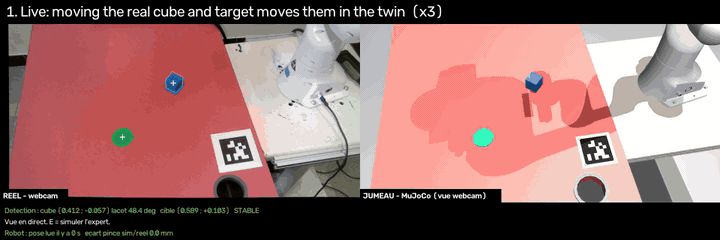
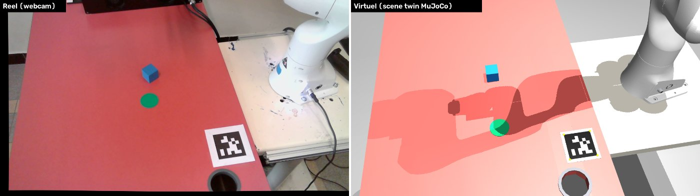

# Panda pick-and-place: imitation learning vs reinforcement learning


A Franka Panda learns to pick up a cube and place it on a target, both placed at random, in MuJoCo.
The same task is solved twice: once by **imitating a scripted expert from camera images**, once by
**reinforcement learning from a reward only**, so the two approaches can be compared.

This is my final-year engineering project (PFE, Polytech Montpellier),
*Digital twin and AI for autonomous robotic manipulation with a Franka Panda*.
It started in simulation on a laptop CPU, and now runs on the **real robot through a live digital twin**
(see [Digital twin on the real robot](#digital-twin-on-the-real-robot)).



*Left: the real setup seen by the webcam. Right: its digital twin in MuJoCo, updated live. The expert is first
played in the twin, then the real robot replays exactly the same motion while the twin follows it.
[Full video](media/digital_twin.mp4).*

| Scripted expert | Imitation learning (2 cameras) | Reinforcement learning (SAC) |
|:---:|:---:|:---:|
|  |  |  |
| reads the exact simulator state | sees only a fixed camera, a wrist camera and its joint angles (right panels) | learns from a reward, no demonstrations |

## Results

Evaluated on 50 cube and target positions never seen during training.

| | Imitation learning (behavior cloning) | Reinforcement learning (SAC) |
|---|---|---|
| Input | 2 RGB cameras (96 × 96) + 7 joint angles + gripper width | exact state (tool, cube and target positions) |
| What it needs | a scripted expert and 150 demonstrations | a well-designed reward |
| Success | **50/50** | **49/50** |
| Compute (laptop CPU) | ~20 min of demos + ~50 min of training | ~4 h for 500k steps |
| Hardest part | choosing the cameras, designing an imitable expert | writing the reward |

The comparison is not yet apples to apples: the IL policy works from images, the RL policy from the exact state.
The [Perception](#perception-simulated-rgb-d-camera) section below replaces that exact state with positions estimated
by a simulated depth camera.

## Digital twin on the real robot

The twin is a MuJoCo copy of **this** robot and **this** lab bench, kept in sync with reality, and used to
check a motion **before** the real robot executes it.

| Live update | Check in the twin (key E) | Execute on the robot (key R) |
|---|---|---|
| A webcam detects the cube and the target ~6 times per second; they move in the twin as they move on the table. The virtual arm copies the real joint angles. | The scripted expert plans the pick-and-place from the real arm pose and plays it in MuJoCo: inverse kinematics, collisions with the tables, grasp, placement. | Only if the simulation succeeded and nothing moved since: the real Panda replays **the same joint waypoints**, slowly. The twin follows the real arm at 25 Hz, then the webcam measures where the cube really ended up. |

**Calibrating the twin.** Everything is expressed in the robot base frame and measured with the robot itself
(a pencil held in the gripper, its tip located to ~1–2 mm):

- **Webcam pose**: an AprilTag (tag36h11, 80 mm) is glued on the table. Its 4 corners were touched with the pencil
  (rigid fit residuals ≤ 1.4 mm), and `solvePnP` on the tag gives the camera pose at every session, so a bumped tripod
  is detected and corrected (`perception/recaler_webcam.py`). Intrinsics: Zhang's method, 45 images, 0.63 px.
- **Scene**: the work table is not level (plane fitted on 9 touched points, 2.1° slope, residuals ≤ 2.7 mm), and its
  cable hole is modelled as a real hole. Simulated and real images overlap edge for edge (`perception/superposition.py`):

  
- **Robot model**: for the same joint angles, the fingertip position computed by MuJoCo (Menagerie model, TCP 103.4 mm
  below the flange) and the one reported by the robot (`O_T_EE`) differ by **0.002 mm**. Gravity compensation is turned
  on for the simulated arm: without it, the Menagerie position actuators sag by 5–7 mm under the arm's weight, while
  the real Panda compensates gravity itself.

**Perception** (webcam only, `perception/detection.py`): HSV thresholding, then the cube mask is refined with a
blue-minus-red channel and Otsu's threshold, and a **3D cube model is fitted to the silhouette** (position and yaw that
maximize the overlap of the projected cube with the mask). Checked against the robot (open gripper centred on the cube),
8 trials, leave-one-out cross-validation: **cube 1.8 mm (max 2.9 mm), yaw 3.2° (max 7.4°), target 2.6 mm**.
The simpler "centre of the blob + minimum rectangle" gave 2.5 mm and 9.0° (max 21.5°).

**Why joint waypoints.** The real robot must execute exactly what was checked. The expert (same logic as
`common/test_expert.py`: above the cube, down, close, up, transport, down, open, up, back) is written as 7-joint
waypoints solved by IK. libfranka joins them with its synchronized joint motion generator; the twin replays the same
joint-space interpolation. Among the four gripper orientations that grasp the cube flat (yaw modulo 90°), the planner
keeps the one with the shortest joint path, so the wrist does not spin for nothing.

**Safety checks before the robot moves**: successful simulation; cube and target unchanged since (6 mm, 8°);
robot still at the start pose used by the simulation (0.03 rad, checked on both PCs); sim/real fingertip gap < 10 mm;
joint limits, speed ≤ 0.3 and grasp force 5–40 N checked by the robot server; low libfranka collision thresholds;
failed grasp → gripper reopens and the arm goes back up.

**First results on the real robot** (23/11/2026, speed factor 0.1, one run ≈ 30 s):

| | value |
|---|---|
| Runs executed | 8 |
| Placement error measured by the webcam (5 runs) | **1.0 / 2.9 / 3.5 / 4.1 / 2.9 mm** |
| Same runs in the twin before execution | 2.0–3.7 mm |
| Not yet explained | 2 runs with the final cube 11 and 24 cm away from the target, 1 libfranka stop at the first run |

The detailed log of every run (plan, simulated and measured errors, joint angles at each waypoint, gripper width)
is in `jumeau/results/`.

**Architecture.** libfranka needs Linux with a 1 kHz control loop, so the work is split over two PCs on the same
network: the Windows laptop runs the webcam, the detection, MuJoCo and the planner; the Ubuntu PC runs a small TCP
server (`ubuntu/serveur_robot.py`, standard library only) and a C++ libfranka 0.8.0 program (`ubuntu/jumeau_robot.cpp`)
that reads the robot state or executes a validated list of waypoints. While moving, the 1 kHz loop only stores the
measured joint angles in atomic variables; another thread sends them every 40 ms, so the real-time loop is never slowed
down by the network.

```
webcam ──> detection (cube, target) ──> MuJoCo twin ──> expert planned + played in the twin (E)
                                              ▲                     │ OK, nothing moved
                                              │ joint angles (25 Hz)│ waypoints (R)
                                              └──── Ubuntu: serveur_robot.py ──> jumeau_robot (libfranka) ──> Panda
```

## The task

- **Robot**: Franka Panda from [MuJoCo Menagerie](https://github.com/google-deepmind/mujoco_menagerie), controlled with
  4 actions: a Cartesian displacement of the tool (up to 2 cm per step) and open/close the gripper.
  A differential IK (damped least squares, null-space pull for the 7th joint) turns the displacement into joint targets.
- **Episode**: 100 steps of 40 ms (4 s). Cube (4 cm) and green target mark drawn at random on the table.
- **Success**: at the end of the episode, the cube rests within 3 cm of the target **and has been released**.

## Imitation learning

1. A **scripted expert** (state machine + proportional controller) reads the exact simulator state and solves the task 49/50.
2. It records 150 demonstrations: camera images, joint angles, and its own actions.
3. A **CNN per camera + an MLP** learns to reproduce the expert's action from what the robot can actually sense.


Getting from 11/50 to 50/50 was a debugging exercise. A diagnostic script (`il/diagnose_bc_vision.py`) splits
each failure into perception, imitation and closed-loop drift, using the simulator's ground truth:

- **The expert must be imitable.** My first expert remembered its phase and used a timer to close the gripper,
  which is invisible in a single image. A memoryless expert, which decides only from the current scene, took the policy from 16/50 to 35/50.
- **Cameras matter more than the network.** With a single front camera, the gripper hid the target at the moment of placing the cube.
  Adding a wrist camera took the policy from 35/50 to 50/50: the fixed camera tells *where to go*, the wrist camera gives the final precision.
- DAgger (the expert relabels the states the policy visits) was implemented but not needed in the end.

## Reinforcement learning

SAC (Stable-Baselines3) on the exact state, with a staged reward: reach the cube, hold it, bring it to the target, release it.


Most of the work went into the reward, and each failure is a classic RL lesson:

- **Reward hacking (v1).** Success only asked for the cube to be on the target. The robot reached 100% by placing the cube
  and *never letting go*. Fix: success requires the gripper to be open.
- **Local optimum.** When releasing became more valuable, holding the cube far from the target still paid enough:
  the robot grasped it and stopped there. Fix: each stage must pay clearly more than the previous one.
- **Reward valley.** While opening, the gripper spent two steps neither "holding" nor "released", where the reward collapsed
  just before the success bonus. The robot never crossed it. Fix: "released" starts exactly where "holding" ends.

The final policy succeeds 49/50 and is faster than the expert. It does not retract the arm after releasing,
because nothing rewards it yet. The RL agent only does what the reward asks.

## Perception (simulated RGB-D camera)

So far the expert and the RL policy read the cube and target positions straight from the simulator.
Here they come from a **simulated depth camera** instead, through a classic detection pipeline.
Everything else the policy sees (tool position and speed, gripper opening) still comes from the robot itself,
as on the real Panda (joint encoders + kinematics).


*Left: the simulated camera, with the detection drawn (yellow: cube, cyan: target, dot: estimated center,
white cross: true position). Right: the scene. The SAC policy (retrained, see below) receives only the estimated
positions.*

**Pipeline** (`perception/`, OpenCV + NumPy, no learning; detection + 3D take ~2 ms per image on CPU):

1. **Camera** (`realsense.py`): a fixed RGB-D camera beside the table, modelled on an Intel RealSense D435:
   424 × 240, 42° vertical field of view, depth aligned to color and rounded to 1 mm, depth noise growing with
   the square of the distance, 1% of pixels without depth, noise on the color image.
   It looks from the side because the fingers open along x: from there the cube stays visible *between* the
   fingers while it is carried (from the front, the hand hid it and tracking was lost).
2. **Detection** (`detector.py`): HSV thresholding (red cube, green target), morphological opening and closing,
   largest contour.
3. **3D position**: the pixels of the contour that have a valid depth are back-projected with the camera
   intrinsics and pose into a point cloud of the *visible surface*. The camera never sees an object's center:
   - cube (known size, upright): center = half a side below the top face and half a side behind the side face
     facing the camera;
   - target mark: middle of its extent (the median is pulled toward the camera, because the near half of a mark
     seen at an angle covers more pixels), raised by half a cube, since the policies use "where the cube's center
     should end up".
4. **Tracking**: an object that is not seen keeps its last estimate; the target, which never moves, is only
   updated when at least 90% of it is visible (the cube placed on it would otherwise shift it).

**Position error** (50 test episodes, the expert acting on the exact state, 5,000 images):

| | mean | 95th percentile | max | detected |
|---|---|---|---|---|
| Cube on the table | 0.10 cm | 0.23 cm | 0.57 cm | 100% of images |
| Cube in the gripper | 0.14 cm | 0.31 cm | 0.72 cm | 100% of images |
| Target | 0.19 cm | 0.43 cm | 0.61 cm | 95% of images |


**Success with the estimated state** (the same 50 test episodes; the policies are *not* retrained):

| Policy | exact state | estimated state |
|---|---|---|
| Scripted expert | 49/50 | **50/50** |
| SAC (retrained for this test, see below) | 50/50 | **50/50** |

The SAC model files are not stored in the repository, so for this test SAC was retrained with `rl/train_rl.py`
(500k steps, same settings, seed 0). This retrained model differs from the one in the Results table above
(49/50); its own exact-state score is given in the table so that the comparison is like for like.
With millimetre-level errors, the estimated state changes nothing measurable: SAC succeeds 50/50 in both cases,
and the expert's one extra success is within the variation from episode to episode (seed 42, the one it misses with
the exact state, is a borderline case for it).

**How far does it hold?** The expert on the estimated state, in degraded conditions (`perception/robustness.py`;
SAC was not tested under these conditions):

| Condition | cube error (mean / max) | success |
|---|---|---|
| Reference (noisy camera, perfect calibration) | 0.11 / 0.54 cm | 50/50 |
| Rendering with shadows | 0.11 / 0.62 cm | 48/50 |
| Camera pose wrong by 5 mm and 1° | 1.19 / 2.22 cm | 48/50 |
| Camera pose wrong by 10 mm and 2° | 2.34 / 3.61 cm | **0/50** |

The detection itself is not the weak point; **the camera calibration is**. With a 10 mm / 2° error on the camera
pose, the cube is estimated about 2 cm away from where it really is (18 mm sideways and 12 mm too low in the
episode I inspected). The gripper, which knows its own position exactly, goes down beside the cube and closes on
nothing, every time. On the real robot this means a careful hand-eye calibration, or a final approach guided by
the wrist camera.

**Limits.** This is simulation only, and the setting is easy for a camera: two saturated colors on a plain floor,
constant lighting, no motion blur, no reflections, image and depth perfectly synchronized, exact intrinsics, a
single cube of known size that stays upright. Shadows are off by default (much faster with software rendering) and
tested separately above. A real RealSense adds edge artifacts and holes on dark or shiny surfaces, and the hand-eye
calibration is never perfect, so the millimetre errors above are a lower bound, not a prediction for the real setup.
The GIF shows the noise-free image of the same camera for readability; the detection drawn on it ran on the noisy
image, as in all the numbers above.

## Repository layout

```
common/   panda_pick_env.py   Gymnasium env: robot, cube, target, 2 cameras, IK, reward
          test_expert.py      scripted, memoryless expert + its test
          twin_scene.py       digital twin scene: the real tables, hole, tag, cube, target, calibrated cameras
il/       record_demos*.py, train_bc*.py, diagnose_bc_vision.py, dagger.py
rl/       train_rl.py, eval_rl.py
perception/
          realsense.py        simulated RGB-D camera (RealSense D435-like)
          detector.py         HSV detection, 3D position of cube and target, tracking
          eval_perception.py  position error on 50 episodes + figure
          compare_policies.py success with the exact vs the estimated state (expert, SAC)
          robustness.py       shadows and camera calibration errors
          make_gif.py         perception GIF / MP4
          results/            JSON and CSV of the numbers above
          real setup (webcam + RealSense D435, robot base frame):
          calib_webcam.py, apriltag_pose.py, recaler_webcam.py   intrinsics, tag pose, per-session re-calibration
          detection.py        cube (3D model fit) and target on the real webcam
          evaluer_detection.py, corriger_detection.py, erreur_detection.py, verifier_lacet.py   error vs the robot
          d435_tag.py, calib_d435.py   hand-eye calibration of the wrist D435
          superposition.py    real image vs rendered twin
          *.json              calibration of the lab setup
jumeau/   jumeau_live.py      live twin: E = simulate, R = execute, V = record real | twin video
          planif_expert.py    expert as joint waypoints, replay and checks in MuJoCo
          lien_robot.py       client for the Ubuntu server
          video_sim.py        clean video / GIF of a simulated episode
          results/            log of the real runs
ubuntu/   serveur_robot.py    TCP server on the robot PC
          jumeau_robot.cpp    libfranka 0.8.0 program: read the state, execute waypoints, stream joint angles
          envoyer_ubuntu.py   copies these files to the robot PC over the network
videos/   make_videos.py      renders the videos above
media/    GIFs, MP4s and figures used in this README
```

## Quick start

```bash
python -m venv venv && venv\Scripts\activate          # Windows (source venv/bin/activate on Linux)
python -m pip install -r requirements.txt
git clone --depth 1 https://github.com/google-deepmind/mujoco_menagerie.git   # robot model, at the repo root

python common/test_expert.py --view       # watch the expert
python il/record_demos_vision.py          # 150 demos with both cameras
python il/train_bc_vision.py              # train + evaluate on 50 unseen episodes
python il/train_bc_vision.py --eval --view
python rl/train_rl.py 500000              # SAC, a few hours on CPU
python rl/eval_rl.py --view
python videos/make_videos.py              # expert / IL / RL videos

python perception/eval_perception.py      # position error on 50 episodes (~10 min on CPU)
python perception/compare_policies.py     # exact vs estimated state (expert, + SAC if rl/sac_best.zip exists)
python perception/robustness.py           # shadows, calibration errors (~1 h on CPU)
python perception/make_gif.py             # perception GIF
```

Every script writes its outputs (demos, models, logs) next to itself.

**Digital twin with the real robot** (the calibration files in `perception/` describe my lab setup):

```bash
# Ubuntu PC connected to the robot: copy jumeau_robot.cpp into libfranka-0.8.0/examples, add it to the examples'
# CMakeLists.txt, build it (cmake --build . --target jumeau_robot), then
python3 serveur_robot.py --confirmer       # --confirmer: press Enter on this PC before every motion

# Windows PC (same network)
python perception/recaler_webcam.py       # tag visible: update the webcam pose
python jumeau/jumeau_live.py --robot <IP of the Ubuntu PC>
python jumeau/jumeau_live.py              # without robot: simulation only
python jumeau/video_sim.py --gif          # video of the last trajectory, simulated
```

## Next steps

- A longer series of real runs (10–20 positions, yaw 0–90°) to compare twin and reality statistically.
- Train the IL and RL policies in the calibrated twin and run them on the real robot through the same
  check-then-execute loop, against the expert.
- Use the wrist RealSense D435 (already calibrated hand-eye): check the grasp, refine the cube position just before
  grasping, obstacles from depth.
- Human demonstrations through teleoperation (haptic interface) instead of a scripted expert.
- Obstacle avoidance, then the same task in Isaac Sim.
